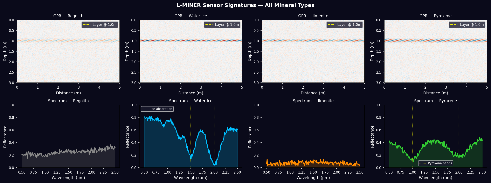

# L-MINER — Lunar Mineral Detection Payload (Simulated AI Rover System)

Built for **ISSSP 2026**, L-MINER is a simulated AI-powered lunar rover payload 
designed to detect and classify minerals at the Moon's South Pole using 
multi-sensor fusion (GPR, spectrometer, stereo camera).

## What it does
- Simulates a three-layer AI hierarchy for onboard mineral classification
- Uses a Random Forest classifier trained on USGS splib07 spectral library data
- Includes 3D visualization of terrain/mineral detection output
- Dashboard for real-time sensor data monitoring and classification results

## Screenshots

## Tech stack
Python · scikit-learn (Random Forest) · Streamlit (dashboard) · Plotly/Matplotlib (3D viz)

## Files
- `dashboard.py` — main dashboard interface
- `model.py` / `l0_l1_logic.py` — classification model and sensor-layer logic
- `visualization_3d.py` — 3D terrain/mineral visualization
- `data_generator.py` — synthetic sensor data generation for simulation
- `lminer_model.pkl` / `lminer_scaler.pkl` — trained model artifacts

## Team
Led by Haider Taqveen, with Hajra, Abdul Wasay, Mohsin, Adan, and Saad — 
supervised by Dr. Sajid Ghuffar, Institute of Space Technology.
